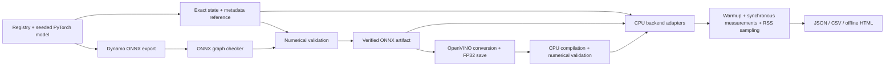

# edge-infer-bench

**Model Conversion & Inference Benchmark Toolkit · v0.1.1 · CPU · MIT**

Export a PyTorch model, verify its converted outputs against the exact original
weights, and measure CPU inference with a reproducible input and thread policy.
`edgebench` produces machine-readable results and an offline technical HTML report.

ML engineers need evidence that a conversion works and a clear account of what a
performance measurement includes. EdgeInferBench keeps source weights, conversion
provenance, correctness results, raw timings, and environment metadata together.
Every reported latency comes from actual synchronous inference.

## Features

- torchvision ResNet18, ResNet50, MobileNetV2; deterministic offline random weights.
- Current `torch.onnx.export(..., dynamo=True)` with checked dynamic-batch ONNX.
- Checksummed reference bundles containing the exact state dictionary and input contract.
- ONNX → OpenVINO IR with FP32 weights (`compress_to_fp16=False`).
- CPU adapters for PyTorch, ONNX Runtime, and optional OpenVINO.
- Multiple deterministic validation inputs and batches, output shapes/dtypes,
  NaN/Inf rejection, absolute/relative error metrics, configurable `allclose` tolerances.
- Fresh child-process trials with crash/timeout diagnostics, median aggregation, exploratory
  bootstrap intervals, between-trial variability, and exact execution order.
- Warmup, P50/P95/P99, mean/std/min/max, throughput, sampled process RSS,
  baseline/post-load/peak/incremental memory, artifact size, and raw timings.
- JSON, CSV, and self-contained HTML, with comparison groups and offline charts.
- An extensible Python API, CLI, pytest suite, and Linux CPU CI workflow.

## Supported backends

| Backend | Device | Dependency | Settings |
|---|---|---|---|
| PyTorch | CPU | Core | inference mode, FP32, configured intra-op threads |
| ONNX Runtime | CPUExecutionProvider | Core | sequential execution, full graph optimization |
| OpenVINO | CPU | Optional `openvino` extra | FP32 hint, LATENCY, one stream |

OpenVINO primarily documents/validates Intel and supported ARM hardware. An AMD CPU
is **not presumed supported**. `info` reports import/device availability, not proof
of execution. `convert` compiles and numerically verifies real CPU inference before
publishing IR. Unavailable runtime benchmarks are recorded as skipped, with reasons,
and exit nonzero. See [the actual development results](docs/development-results.md).

Actual Ryzen 7 4800H development runs are included: [offline HTML](examples/measured/ryzen4800h/benchmark.html),
[CSV](examples/measured/ryzen4800h/benchmark.csv), and [full JSON](examples/measured/ryzen4800h/benchmark.json).
They contain 16 measured ResNet50/MobileNetV2 batch rows and 4 explicit OpenVINO
skips. Read the execution notes before interpreting the short trials.

The v0.1.1 standard batch-1 run (five isolated trials, 20/200, four threads) is
retained in [examples/measured/v011-standard](examples/measured/v011-standard). It
contains actual P50/P95/P99, throughput, confidence intervals, trial variability,
and RSS for ResNet50 and MobileNetV2 on PyTorch CPU and ONNX Runtime CPU.

## Architecture



Engines live separately from CLI handlers. The model registry maps names to
factories and input specifications; adapters normalize outputs into ordered NumPy
arrays. Conversion checks and benchmarking use the same adapters and input generator.
See the [Python API](docs/python-api.md) and [file inventory](docs/files.md).

## Installation

Python 3.11–3.13 on Linux. No CUDA or NVIDIA GPU is needed. An initial internet
connection is required to install dependencies; default model execution is offline.

Using [uv](https://docs.astral.sh/uv/):

```bash
uv sync --extra dev
source .venv/bin/activate
edgebench --help
edgebench info
```

The project config selects the official CPU wheel index for torch/torchvision.
For OpenVINO, use `uv sync --extra dev --extra openvino`. An extra being installed
does not guarantee hardware/runtime compatibility.

With pip in a virtual environment:

```bash
python3.11 -m venv .venv
source .venv/bin/activate
python -m pip install --upgrade pip
python -m pip install torch torchvision --index-url https://download.pytorch.org/whl/cpu
python -m pip install -e '.[dev]'
# Optional:
python -m pip install -e '.[dev,openvino]'
```

Torch and torchvision must be a compatible pair; the package resolver uses their
published requirements. Install CPU wheels first with pip to avoid default CUDA wheels.

## NixOS setup

The devShell supplies Python 3.11, uv, and native C++/zlib/GL libraries locally. It
sets `LD_LIBRARY_PATH` only within the shell; no sudo, global pip installation, or
NixOS configuration changes are required.

```bash
nix flake lock
nix develop
uv sync --extra dev
source .venv/bin/activate
edgebench info
pytest -q
```

Commit the generated `flake.lock` and `uv.lock` in your own checkout to pin your
resolved environment. Lock generation and fresh network installs could not be tested
in the restricted development session; see [environment evidence](docs/development-results.md).
The flake targets `nixos-26.05` and offers x86_64/aarch64 Linux shells; runtime support
must be checked on each platform. If native wheel imports fail, enter `nix develop`
before invoking Python. `nix-ld` alone may not expose C++ libraries to a Nix-linked
Python interpreter. Keep fixes within the devShell.

## Quick start

Run from the repository after installation. These paths must be new: exports refuse
to overwrite existing models/reference bundles. The tiny network makes a fast initial check:

```bash
edgebench export --model tiny --output artifacts/tiny.onnx --dynamic-batch --seed 42
edgebench validate --reference artifacts/tiny_reference --target artifacts/tiny.onnx \
  --backend onnxruntime --batch-sizes 1,4,8,16 --output results/tiny_validation.json
edgebench benchmark --model artifacts/tiny_reference --backend pytorch \
  --mode smoke --batch-sizes 1,4,8,16 --threads 4 --output results/tiny_pt.json
edgebench benchmark --model artifacts/tiny.onnx --backend onnxruntime \
  --mode smoke --batch-sizes 1,4,8,16 --threads 4 --output results/tiny_ort.json
edgebench report --input results/ --format html --output reports/benchmark.html
edgebench report --input results/ --format csv --output reports/benchmark.csv
edgebench report --input results/ --format json --output reports/benchmark.json
```

For torchvision models, see the fully executable [CPU example](examples/benchmark_cpu.sh).
`tiny` is a small convolutional network included for fast integration tests, not a
representative image-classification performance workload.

## CLI reference

Run `edgebench COMMAND --help` for all options. Positive batch sizes must be unique.

| Command | Purpose | Main options |
|---|---|---|
| `info` | OS/CPU/Python, versions, available providers/devices | `--json` |
| `export` | Export ONNX, persist reference, check graph and numerical outputs | `--model`, `--output`, `--format onnx`, `--batch-size`, `--dynamic-batch/--fixed-batch`, `--seed`, `--threads`, `--pretrained` |
| `convert` | ONNX → OpenVINO, save FP32, compile and verify CPU | `--input`, `--output`, `--format openvino`, `--threads` |
| `validate` | Compare original reference and target inference | `--reference`, `--target`, `--backend`, `--batch-sizes`, `--inputs`, `--atol`, `--rtol`, `--seed`, `--threads`, `--output` |
| `benchmark` | Measure actual synchronous CPU inference in fresh child trials | `--model`, `--backend`, `--mode`, `--trials`, `--batch-sizes`, `--warmup`, `--iterations`, `--threads`, `--seed`, `--timeout`, `--output` |
| `report` | Aggregate benchmark/validation JSON into a report | `--input`, `--format html/csv/json`, `--output` |

Standard benchmark settings are 5 independent child trials, 20 warmups, 200
measurements, batches 1/4/8/16, 4 requested threads, and seed 42. `--mode smoke`
selects 3 trials, 5 warmups, and 30 measurements. A separate first inference occurs
before warmup. Aggregates are medians of trial summaries; bootstrap confidence
intervals are shown only when at least 3 trials complete. Numerical defaults are
`atol=1e-4`, `rtol=1e-3`, and 3 inputs per batch.

Validation failures and incomplete/skipped benchmarks exit 1. Usage errors exit 2.
Detailed numerical failure JSON is saved when `validate --output` is specified.
Failed/skipped benchmark rows contain reasons and no invented numeric metrics.

### ResNet50 and OpenVINO

```bash
edgebench export --model resnet50 --format onnx --batch-size 1 --dynamic-batch \
  --seed 42 --output artifacts/resnet50.onnx
edgebench validate --reference artifacts/resnet50_reference --target artifacts/resnet50.onnx \
  --backend onnxruntime --batch-sizes 1,4,8 --atol 1e-4 --rtol 1e-3
edgebench convert --input artifacts/resnet50.onnx --format openvino \
  --output artifacts/resnet50.xml
edgebench benchmark --model artifacts/resnet50.xml --backend openvino \
  --batch-sizes 1,4,8,16 --warmup 20 --iterations 200 --threads 4 \
  --output results/ov_resnet50.json
```

Only run the last two commands when OpenVINO is installed. Conversion intentionally
fails if CPU compilation/inference or numerical equivalence fails. FP32 weights and
an FP32 execution hint are explicit; hardware kernels can still differ numerically.

### Artifacts and trust

`artifacts/resnet50.onnx` has a `resnet50.onnx.json` sidecar and a
`resnet50_reference/` directory with `state.pt` and `metadata.json`. Keep all three.
The bundle stores architecture, versions, seed, original state dictionary checksum,
preprocessing guidance, FP32 input specification, and provenance. IR adds `.xml`,
`.bin`, and `.xml.json`. Checksums detect accidental changes, not malicious tampering.

Only load trusted artifacts. PyTorch restoration uses `weights_only=True`, never
unpickles an arbitrary model object, and checks the state checksum before loading.
Restricted deserialization is not a security sandbox. ONNX/OpenVINO native parsers
also require trusted inputs. Reference restoration requires the recorded torchvision
version and a compatible registered factory. Custom registry entries must be
registered again in the restoring process.

Dynamic export uses a trace batch of at least 2 to avoid batch-1 specialization;
the published model is actually verified at batches 1 and 4 with two inputs each.
If export cannot support dynamic batching, use `--fixed-batch --batch-size N` and
validate/benchmark only N. There is no silent exporter fallback.

## Correctness and accuracy

The validation table shows batch/input/output, absolute error, relative error, and
pass/fail. Detailed JSON additionally records mean relative error, output shapes,
dtypes, mismatched elements/counts, tolerances, and non-finite failures.
The relative-error denominator is `max(abs(reference), 1e-8)`.
Pass/fail uses `abs(target-reference) <= atol + rtol*abs(reference)`, matching
`numpy.allclose(target, reference)`, plus identical dtype/shape and finite outputs.
See [actual numerical outcomes](docs/development-results.md) for measured values.

Default `weights=None` is deliberate: random models measure execution performance
and conversion fidelity without downloads. **Numerical correctness does not
establish predictive accuracy.** `--pretrained` explicitly requests torchvision
DEFAULT weights and may download a large file into torchvision's cache. Accuracy
testing requires representative data and the selected weights' transforms; it is
outside v0.1.1. Image decoding and preprocessing are not timed.

## Benchmark methodology and reproduction

Read [benchmark-methodology.md](docs/benchmark-methodology.md) before interpreting results.
Inference uses `perf_counter_ns()`, synchronous CPU execution, and identical FP32
NCHW synthetic inputs. Throughput is actual processed samples / timed inference
seconds, not the reciprocal of a percentile. RSS is total process memory in decimal
MB, sampled outside the timing loop; observed peaks can miss short allocations.

Each configured trial is a fresh child interpreter; the parent retains successful,
failed, skipped, timed-out, and crashed trials. Use standard mode for engineering
measurements and smoke mode only for development. Keep backend runs on the same
physical machine, stable power/thermal conditions, an idle machine, and consistent
affinity; rotate backend order when comparing. Preserve JSON results (including raw
nanosecond durations), model/reference/sidecar files, dependency locks, and source
revision. Batch rows within one trial can retain allocator memory from earlier rows.
Microbenchmarks are **not end-to-end application performance**.

Reports compare only matching source identity, input spec, precision, batch, relevant
configuration, and recorded environment. CPU scheduling and graph optimization
policies remain backend-specific and are disclosed. Different machines/settings
form separate groups; reports do not imply a universal speed ordering. Failed
measurements remain visible. HTML needs no network, JavaScript, or external fonts.

## Development

```bash
ruff check .
ruff format --check .
pytest -q                         # Includes a real ResNet18 smoke test
pytest -q -m 'not smoke'          # Fast suite including tiny-network integration
pytest -q -m openvino            # Explicit skip reasons if runtime is unavailable
python -m build
```

GitHub Actions checks lint/format, builds the wheel, runs lightweight Linux CPU
tests with OpenVINO installed, and runs a separate ResNet18 smoke job. Optional
OpenVINO tests skip on missing imports/device/compile support; numerical failures
on a runnable device are test failures.

## Limitations and roadmap

v0.1.1 supports a single FP32 NCHW tensor input, positional tensor output trees,
CPU inference, and toolkit-produced artifacts with sidecars. No arbitrary checkpoint
architecture inference, CUDA, TensorRT, GPU benchmarks, quantization, serving,
training, or accuracy dataset evaluation. Dictionary outputs use insertion order;
output names are not semantic alignment keys. Export/compile startup timings are
not comparable across backends. Very short runs do not provide reliable P99 estimates.

For v0.2.0: per-batch process isolation, stronger schema migrations, more input
contracts/model plugins, and broader hardware compatibility testing. No performance
claim is made without measurement.

## License

[MIT](LICENSE). Dependencies and model weights retain their own licenses.
